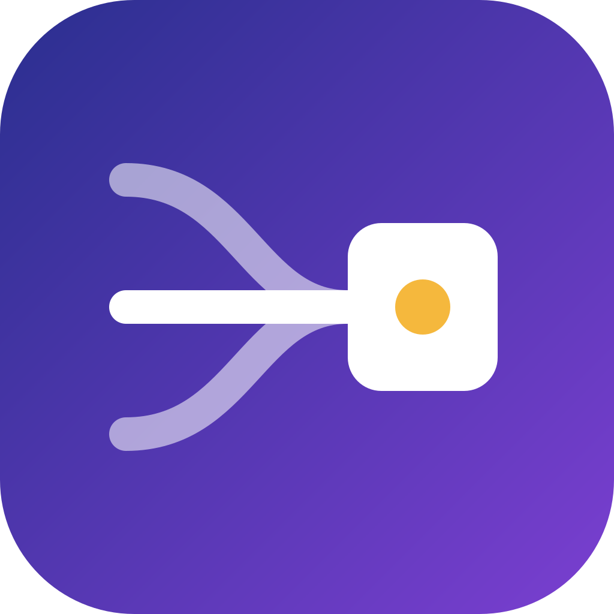
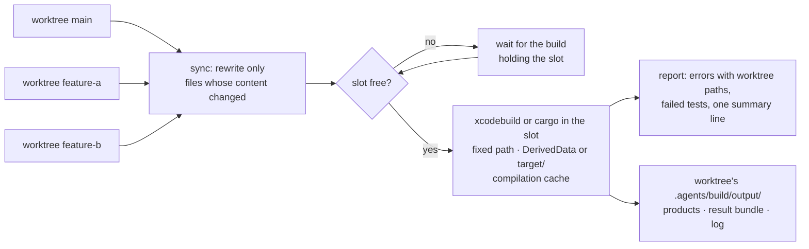

<div align="center">



# agent-build

**Fast command-line Xcode and Cargo builds for many agents in many worktrees, and for CI.**

Every worktree of a project builds in one warm slot at a fixed path,<br>
so a new worktree's first build is incremental instead of cold.

[](#license)
[](#requirements)
[](#preconditions)
[](Cargo.toml)
[](scripts/check-deps.py)

English · [简体中文](README.zh-CN.md)

[Quick start](#quick-start) · [Usage](#usage) · [How it works](#how-it-works) · [FAQ](#faq) · [Design notes](docs/design.md)

</div>

<br>


<sub>Real `xcodebuild` runs on `tests/fixtures/SampleApp`; idle waits are cut. Recorded with [demo-reel](https://github.com/xiatiandeairen/demo-reel) (`examples/agent-build`).</sub>

## Contents

- [Why agent-build](#why-agent-build)
- [Features](#features)
- [Quick start](#quick-start)
- [Install](#install)
- [Usage](#usage)
- [Rust: `agb cargo`](#rust-agb-cargo)
- [Preconditions](#preconditions)
- [Configuration](#configuration)
- [How it works](#how-it-works)
- [What agb runs](#what-agb-runs)
- [Privacy](#privacy)
- [FAQ](#faq)
- [Contributing](#contributing)
- [License](#license)

## Why agent-build

When agents work in many worktrees, every new worktree gets its own DerivedData, and its first `xcodebuild` starts from zero. Two agents building the same project trample each other, and thousands of lines of build output flood their context. `agb` is one word you put in front of `xcodebuild` or `cargo`:

| Problem | What agb does |
| --- | --- |
| A new worktree's first build is a cold build | Builds every worktree of the project in one slot at a fixed path, so the incremental build carries over from one worktree to the next |
| Switching back to a branch built earlier compiles it again | Turns on Xcode's compilation cache in the slot, so anything compiled once is served from it |
| Two agents building the same project trample each other | Builds of one project take turns; the second waits, then builds incrementally in the warm slot. Different projects never wait for each other |
| Thousands of lines of output fill an agent's context | Prints only errors (compiler format, worktree paths), failed tests and one summary line; the full output goes to a log |
| Nobody can tell why a build is slow | Reports time per phase, cache hits and misses, the targets with the most misses, and which [precondition](#preconditions) is not met |

On the sample app in this repository (Xcode 27.2, Apple Silicon), the first build takes 8.4 s and the same build from a second worktree takes 1.5 s. On a 2,400-file app, an earlier prototype of the same design took a new worktree's first build from 178 s to 45 s; this version has not been measured there yet.

agb only changes where and how a build runs. It does not decide how many builds the machine runs at once; pair it with a queue such as [agent-quay](https://github.com/xiatiandeairen/agent-quay) for that.

## Features

- **Drop-in.** Same arguments as `xcodebuild` or `cargo`, with `agb` in front. A standard project needs no configuration.
- **Exact sync.** Each run copies the worktree's exact state into the slot, uncommitted changes included, and rewrites only files whose content changed, so unchanged files keep their timestamps and stay built.
- **Correct by design.** A result is reused only when every input that affects it is the same. agb does not paper over a project that breaks a [precondition](#preconditions); it names the broken one.
- **Short, agent-readable report.** Compiler-format errors that point into your worktree, `agb: test failed:` lines and one `agb: ok` / `agb: failed` summary.
- **Outputs stay with the worktree.** Products, result bundle, archive and log land in the worktree's `.agents/build/output/`; another worktree's build never touches them.
- **Xcode and Rust.** `agb cargo` gives Cargo projects the same slot, sync, lock and output.
- **Nothing extra to run.** No daemon and no third-party crates; slots live in a cache directory you can delete at any time.

## Quick start

```bash
# 1. Install agb (needs Rust 1.85+)
cargo install --git https://github.com/xiatiandeairen/agent-build --locked agent-build

# 2. In any worktree of your project, put agb in front of xcodebuild
agb xcodebuild build -workspace App.xcworkspace -scheme App -destination 'generic/platform=iOS Simulator'
```

The first build of a project is cold; from then on, every worktree of that project builds incrementally in the same slot. To have agents use agb on their own, give them the [skill](#agent-skill).

## Install

### Requirements

- macOS with command-line Xcode (verified with Xcode 27.2 on Apple Silicon)
- The project in git, with its submodules available locally
- Rust 1.85 or later to build agb

### From source

```bash
cargo install --git https://github.com/xiatiandeairen/agent-build --locked agent-build
```

Or from a checkout: `just install` builds and installs `~/.local/bin/agb`.

### Agent skill

[`skill/SKILL.md`](skill/SKILL.md) tells an agent when to use `agb xcodebuild` and `agb cargo` and how to read their output (written in Chinese). For Claude Code, link it into your skills:

```bash
ln -s "$PWD/skill" ~/.claude/skills/agb    # run in the agent-build checkout
```

The skill is instructions only; it runs nothing by itself.

## Usage

```bash
cd my-app                                   # any worktree of the project
agb xcodebuild build -scheme App -destination 'generic/platform=iOS Simulator'
agb xcodebuild test -scheme App -destination 'platform=iOS Simulator,name=iPhone 17 Pro'
agb xcodebuild archive -scheme App          # prints archive=<path>.xcarchive
agb cargo build --release                   # Rust, see below
```

### Output

While the build runs, its output goes to a log; the terminal shows one line with the log's path (`tail -f` it to watch). Afterwards agb reads Xcode's result bundle and prints a short report. The run in the demo above, from the second worktree, after a typo (paths shortened):

```console
$ agb xcodebuild build -scheme App -destination 'generic/platform=iOS Simulator'
agb: building in slot app-c1147f35; xcodebuild's full output: …/app-feature/.agents/build/output/build.log
…/app-feature/App/App.swift:6:37: error: Type 'Greeting' has no member 'title'
agb: phases resolve=0.0s graph=0.0s plan=0.0s execute=1.0s
agb: top misses: App 4
agb: results=…/app-feature/.agents/build/output/result.xcresult
agb: failed slot=app-c1147f35 sync=0.0s build=1.8s cache hit=0 miss=4 errors=1 warnings=0 log=…/app-feature/.agents/build/output/build.log
```

- Errors are printed the way compilers print them, with worktree paths, so editors and agents can jump to them. Warnings are counted; the full list is in the result bundle and the log.
- Failed tests appear as `agb: test failed: <test>: <message>`. A target that misses a precondition appears as `agb: precondition P4 not met: …`.
- Errors Xcode recorded in a build that still succeeded (typically a build script that printed `error:` and exited 0) appear as `agb: error that did not fail the build: …` and are not counted in `errors=`.
- When a failed build leaves no result bundle (for example, the project cannot be read), the last 30 lines of the raw output are printed instead.
- Information commands such as `-showBuildSettings`, `-list` and `-resolvePackageDependencies` show xcodebuild's output as is.

### Where outputs go

A successful build also prints `products=<path>`, and `archive` prints `archive=<path>.xcarchive`. Everything a run hands you is in the worktree's `.agents/build/output/`: products, result bundle, archive and `build.log`. The directory ignores itself in git. Another worktree's build never changes it; this worktree's next build of the same kind replaces it, so copy what you keep.

agb owns the output locations:

- `-derivedDataPath`, `-archivePath`, `-resultBundlePath` and `-clonedSourcePackagesDirPath` are dropped with a notice.
- An absolute path into the worktree given to `-workspace`, `-project` or `-xctestrun` (such as `$PWD/App.xcworkspace`) is pointed at the slot's copy, with a notice.

### Exit codes

| Code | Meaning | Next step |
| --- | --- | --- |
| xcodebuild's or cargo's own (0, 65, …) | The build ran; this is its result | Read the errors above the summary, or the log |
| 64 | Usage error (what xcodebuild itself exits with for bad arguments) | Fix the call; for cargo, run commands agb refuses directly |
| 125 | Syncing the slot failed; nothing was built | Read the message; usually a git or disk problem in the worktree |
| 128 + signal | The build was killed | Run it again |

### Concurrency and CI

Two builds of the same project take turns: the second prints `agb: waiting for the slot: <who holds it>` and then builds incrementally in the warm slot. Different projects never wait for each other. CI uses the same command; configure runners not to run two jobs of the same project at once.

## Rust: `agb cargo`

The same slot, sync, lock and output serve Cargo projects:

```console
$ agb cargo build
agb: building in slot crate-b481e086; cargo's full output: …/crate/.agents/build/output/build.log
agb: rebuilt: sample-core, sample-ffi
agb: products=…/crate/.agents/build/output/target (replaced by this worktree's next agb build; copy what you keep)
agb: ok slot=crate-b481e086 sync=0.1s build=1.3s units fresh=0 rebuilt=4 errors=0 warnings=0 log=…/crate/.agents/build/output/build.log
```

- Cargo runs in the slot with the slot's `target/`, so Cargo's own incremental build carries over from one worktree to the next.
- Accepted: `build`, `check`, `test`, `bench`, `run`, `doc`, `clippy`, `rustc`, `clean`. Commands that change files (`fmt`, `fix`, `add`, `update`), install, publish or only query are refused with exit code 64; run cargo directly for those.
- `--target-dir`, `--message-format` and `CARGO_TARGET_DIR` are owned by agb and dropped with a notice.
- rustc runs without a wrapper such as sccache: the rustc wrapper variables are set empty, which also overrides `build.rustc-wrapper` in Cargo's config. A wrapper's cache key can miss inputs that change the result; reuse is decided by Cargo alone.
- After `build` or `rustc`, the products of the packages you asked for (`.a`, `.dylib`, programs) are copied to `.agents/build/output/target/` at the same paths as in a target directory, e.g. `.agents/build/output/target/aarch64-apple-ios/release/libcore_ffi.a`, so packaging steps after cargo (bindings, `lipo`, xcframeworks) read them there.
- Errors print as `path:line:column: error: message`; rustc's full text is in the log.
- Preconditions beyond P3, P5 and P8: the build depends only on the sources, `Cargo.lock`, the toolchain and the inputs build scripts declare (`rerun-if-changed`, `rerun-if-env-changed`).

## Preconditions

agent-build is fast and correct when these hold; it does not fix a project that breaks them.

| # | Precondition | If not met |
| --- | --- | --- |
| P1 | Built with command-line `xcodebuild` (Swift; mixed ObjC/C is fine) | Not usable |
| P2 | The current Xcode release (verified with 27.2) | Not guaranteed |
| P3 | Code in git; submodules available locally | Not usable |
| P4 | Swift targets use explicit modules | Correct but slower; reported per target |
| P5 | Build scripts do not rewrite tracked files | Correct but slower; the files are reported |
| P6 | Build tools such as macro plugins are reproducible | Correct but slower; see the self-check below |
| P7 | The cache is shared on one machine only | — |
| P8 | A clean checkout builds with plain `xcodebuild` from any directory; git-ignored files the build needs are declared in `.agents/build/config.yaml` | The build fails; when the error mentions the missing ignored file's path, agb names it and says how to declare it |

P6 self-check: delete only the built macro plugin in the slot's DerivedData and build again. If the hit count drops, the plugin binary is not reproducible.

## Configuration

None is needed. The only global setting is the size limit of each project's compilation cache, in `$XDG_CONFIG_HOME/agent-build/config.yaml` (default `~/.config/agent-build/config.yaml`):

```yaml
cache_limit: 20G   # default; binary units, 1G = 1024³ bytes
```

Xcode does not enforce this limit, so agb clears a project's cache when a build leaves it over `cache_limit`; the next build refills it.

A project whose build needs git-ignored files (generated code, `Pods/`, a built xcframework) lists them in `.agents/build/config.yaml` at the repository root, committed with the project. They are then synced like tracked files:

```yaml
ignored_inputs:
  - rust-core/build/
  - App/Generated.swift
```

## How it works



- Each project gets one build slot at a fixed path: a git clone plus a persistent DerivedData (or Cargo `target/`). Because the path never changes, the incremental build carries over from one worktree to the next.
- The slot's compilation cache serves anything already compiled once, such as a branch built earlier.
- Slots and caches live in `$XDG_CACHE_HOME/agent-build/` (default `~/.cache/agent-build/`) and can be deleted at any time; the next build is just cold again.
- [docs/design.md](docs/design.md) (Chinese) explains the goals, the scope and why each mechanism is the way it is.

## What agb runs

agb only runs what you ask it to, plus the plumbing to put it in the slot:

- `xcodebuild` or `cargo`, with your arguments, in the slot. For xcodebuild it adds `-derivedDataPath`, `-resultBundlePath` and the `COMPILATION_CACHE_*` build settings that turn on the compilation cache.
- `git`, on your worktree and the slot only: read-only queries (`rev-parse`, `status`, `ls-files`, `cat-file`, `config --get remote.origin.url`), and in the slot `clone`, `fetch` and `checkout` from your local worktree. Hooks are disabled for these calls.
- `xcrun xcresulttool`, read-only, to read the result bundle after an xcodebuild run.
- `cp`, to copy products out of the slot into `.agents/build/output/`.

## Privacy

agb runs locally, sends no telemetry and opens no network connection itself; the slot is cloned and fetched from your local worktree. The build tools it starts behave as they would without agb: xcodebuild may resolve Swift packages and cargo may download crates from the network, as configured in your project.

## FAQ

<details>
<summary><b>Does it speed up builds inside the Xcode app?</b></summary>

No. agent-build is for command-line `xcodebuild` and `cargo`, run by agents, scripts and CI.
</details>

<details>
<summary><b>Is the result the same as a clean build?</b></summary>

That is the design goal: a result is reused only when every input that affects it is the same. It holds as long as the project meets the [preconditions](#preconditions); when one is not met, agb reports which one instead of guessing.
</details>

<details>
<summary><b>Can several agents build at the same time?</b></summary>

Yes. Builds of the same project take turns in its slot; different projects build in parallel. To cap how many builds run on the machine, run agb through a queue such as [agent-quay](https://github.com/xiatiandeairen/agent-quay): `aq run -- agb xcodebuild …`.
</details>

<details>
<summary><b>My build needs a generated file that git ignores. Why does it fail in the slot?</b></summary>

The slot gets the worktree's files, uncommitted changes included, except the ones git ignores. List the ignored inputs in `.agents/build/config.yaml` (see [Configuration](#configuration)); when the error mentions the missing file's path, agb tells you which one it is.
</details>

<details>
<summary><b>Where did my <code>-derivedDataPath</code> go?</b></summary>

Output locations are owned by agb: the flag is dropped with a notice, and everything a run hands you is in the worktree's `.agents/build/output/`.
</details>

<details>
<summary><b>How do I free disk space?</b></summary>

Delete `$XDG_CACHE_HOME/agent-build/` (default `~/.cache/agent-build/`) at any time; the next build of each project is just cold again. Each project's compilation cache is also capped by `cache_limit`.
</details>

## Contributing

Issues and pull requests are welcome. Before sending a change:

```bash
just check           # format, lint, unit and integration tests, file size, dependencies, case table
just smoke           # the real xcodebuild on the sample projects (a few minutes; borrows an iOS simulator through aq)
```

- No third-party crates, and `agent-build-core` depends on nothing (`just deps` checks this).
- Add new behavior to [`docs/cases.md`](docs/cases.md) first, then tag the test that guards it with its case id.
- Read [`docs/design.md`](docs/design.md) (Chinese) for the goals, the scope and why each mechanism is the way it is.

## License

Licensed under either of [Apache License, Version 2.0](LICENSE-APACHE) or [MIT license](LICENSE-MIT) at your option.
