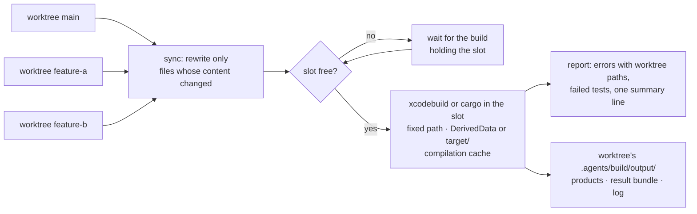

<div align="center">


# agent-build

**Fast command-line Xcode and Cargo builds for many agents in many worktrees, and for CI.**

Every worktree of a project builds in one warm slot at a fixed path,<br>
so a new worktree's first build is incremental instead of cold.

[](#license)
[](#requirements)
[](#preconditions)
[](Cargo.toml)
[](scripts/check-deps.py)

English · [简体中文](README.zh-CN.md)

[Quick start](#quick-start) · [Usage](#usage) · [How it works](#how-it-works) · [FAQ](#faq) · [Design notes](docs/design.md)

</div>

<br>


<sub>Real `xcodebuild` runs on `tests/fixtures/SampleApp`. Re-record with `docs/demo/record.sh`.</sub>

## Contents

- [Why agent-build](#why-agent-build)
- [Features](#features)
- [Quick start](#quick-start)
- [Install](#install)
- [Usage](#usage)
- [Rust: `agb cargo`](#rust-agb-cargo)
- [Preconditions](#preconditions)
- [Configuration](#configuration)
- [How it works](#how-it-works)
- [FAQ](#faq)
- [Contributing](#contributing)
- [License](#license)

## Why agent-build

When agents work in many worktrees, every new worktree gets its own DerivedData and its first `xcodebuild` starts from zero. Put `agb` in front of the command instead:

| Problem | What agb does |
| --- | --- |
| A new worktree's first build is a cold build | Builds every worktree of the project in one slot at a fixed path, so Xcode's incremental build carries over from one worktree to the next |
| Switching back to a branch built earlier compiles it again | Turns on Xcode's compilation cache in the slot, so anything compiled once is served from it |
| Two agents building the same project trample each other | Builds of one project take turns; the second one waits, then builds incrementally in the warm slot. Different projects never wait for each other |
| Thousands of lines of `xcodebuild` output fill an agent's context | Prints only errors (compiler format, worktree paths), failed tests and one summary line; the full output goes to a log |
| Nobody can tell why a build is slow | Reports time per phase, cache hits and misses, the targets with the most misses, and which [precondition](#preconditions) is not met |

Measured with an earlier prototype of the same design on a 2400-file app with Xcode 27.2: a new worktree's first build went from 178 s (cold) to 45 s. This version has not been measured on that app yet.

## Features

- **Drop-in.** Same arguments as `xcodebuild` or `cargo`, with `agb` in front. No configuration for a standard project.
- **Exact sync.** Each run copies the worktree's exact state into the slot, rewriting only files whose content changed, so unchanged files keep their timestamps and stay built.
- **Correct by design.** Reuse happens only when every input that affects the result is the same; agb does not paper over a project that breaks the [preconditions](#preconditions), it names the broken one.
- **Agent-friendly report.** Compiler-format errors that point into your worktree, `agb: test failed:` lines, and a single `agb: ok` / `agb: failed` summary.
- **Outputs stay with the worktree.** Products, result bundle, archive and log land in the worktree's `.agents/build/output/`; another worktree's build never touches them.
- **Xcode and Rust.** `agb cargo` gives Cargo projects the same slot, sync, lock and output.
- **Nothing extra to run.** No daemon and no third-party crates; slots live in a cache directory you can delete at any time.

## Quick start

```bash
# 1. Install agb (needs Rust 1.85+)
cargo install --git https://github.com/xiatiandeairen/agent-build --locked agent-build

# 2. In any worktree of your project, put agb in front of xcodebuild
agb xcodebuild build -workspace App.xcworkspace -scheme App -destination 'generic/platform=iOS Simulator'
```

The first build in a project is cold; from then on, every worktree of the project builds incrementally in the same slot. To have agents use it, give them the [skill](#agent-skill).

## Install

### Requirements

- macOS with command-line Xcode (verified with Xcode 27.2)
- The project in git, with its submodules available locally
- Rust 1.85 or later to build agb

### From source

```bash
cargo install --git https://github.com/xiatiandeairen/agent-build --locked agent-build
```

Or from a checkout: `just install` builds and installs `~/.local/bin/agb`.

### Agent skill

[`skill/SKILL.md`](skill/SKILL.md) tells an agent when to use `agb xcodebuild` and `agb cargo` and how to read their output (written in Chinese). For Claude Code, link it into your skills:

```bash
ln -s "$PWD/skill" ~/.claude/skills/agb    # run in the agent-build checkout
```

## Usage

```bash
cd my-app            # any worktree of the project
agb xcodebuild build -workspace App.xcworkspace -scheme App -destination 'generic/platform=iOS Simulator'
agb xcodebuild test -scheme App -destination 'platform=iOS Simulator,name=iPhone 17 Pro'
```

### What you see

While xcodebuild runs, its output goes to a log file; the terminal shows one line with the log's path (`tail -f` it to watch). Afterwards agb reads Xcode's result bundle with `xcresulttool` and prints, in order:

```
/Users/me/my-app/App/Login.swift:42:9: error: Cannot find 'session' in scope
agb: test failed: CoreTests/testLogin(): XCTAssertEqual failed: ("1") is not equal to ("2")
agb: phases resolve=7.7s graph=5.5s plan=2.0s execute=18.6s
agb: precondition P4 not met: App (explicit modules off) — their Swift compiles are not cached
agb: top misses: MXAIModule 15, MXAIUIModule 8
agb: results=/Users/me/my-app/.agents/build/output/result.xcresult
agb: failed slot=my-app-1a2b3c4d sync=1.1s build=35.9s cache hit=46 miss=23 errors=1 warnings=12 log=/Users/me/my-app/.agents/build/output/build.log
```

- Errors are printed the way compilers print them, with worktree paths, so editors and agents can jump to them; warnings are counted, and listed in full in the result bundle and the log.
- Errors Xcode recorded in a build that still succeeded (exit code 0), typically a build script that printed `error:` and exited 0, are printed as `agb: error that did not fail the build: …`, not in compiler format, and are not counted in `errors=`.
- When a failed build leaves no result bundle (for example, the project cannot be read), the last 30 lines of the raw output are printed instead.
- Commands that only print information, such as `-showBuildSettings` and `-list`, show xcodebuild's output as is.
- A successful build also prints `products=<path>`, and `archive` prints `archive=<path>.xcarchive`. A failed build points only at its result bundle. Everything a run hands you is in the worktree's `.agents/build/output/` (products, result bundle, archive, `build.log`), which ignores itself in git. Another worktree's build never changes it; this worktree's next run that makes the same kind of output replaces it, so copy what you keep. `test-without-building` leaves the products it tests. Information commands leave it untouched.
- `-derivedDataPath`, `-archivePath`, `-resultBundlePath` and `-clonedSourcePackagesDirPath` are dropped with a notice: outputs go to `.agents/build/output/` and package checkouts stay in the slot.
- An absolute path into the worktree given to `-workspace`, `-project` or `-xctestrun` (such as `$PWD/App.xcworkspace`) is pointed at the slot's copy, with a notice.
- `-resolvePackageDependencies` is treated like the information commands; its checkouts land in the slot.

### Exit codes

| Code | Meaning |
| --- | --- |
| xcodebuild's or cargo's own | The build ran; its result as is |
| 64 | Usage error (the same code xcodebuild uses for its own) |
| 125 | Syncing the slot failed, nothing was built (the usual "the wrapper itself failed" code of `env` and `timeout`) |

### Concurrency and CI

Two builds of the same project take turns: the second prints whom it is waiting for and then builds incrementally in the warm slot. Different projects never wait for each other. How many builds run at once on the machine is left to your queue (for example [agent-quay](https://github.com/xiatiandeairen/agent-quay)). CI uses the same command; configure runners not to run two jobs of the same project at once.

## Rust: `agb cargo`

The same slot, sync, lock and output serve Cargo projects. Put `agb` in front of `cargo`:

```bash
agb cargo build --release -p core-ffi --target aarch64-apple-ios
agb cargo test
```

- Cargo runs in the slot with the slot's `target/`, so Cargo's own incremental build carries over from one worktree to the next. Only `build`, `check`, `test`, `bench`, `run`, `doc`, `clippy`, `rustc` and `clean` are accepted; commands that change files (`fmt`, `fix`, `add`, `update`), install, publish or only query are refused with exit code 64: run cargo directly for those.
- `--target-dir`, `--message-format` and `CARGO_TARGET_DIR` are owned by agb and dropped with a notice.
- rustc runs without a wrapper (kache, sccache): the rustc wrapper variables are set empty, which also overrides `build.rustc-wrapper` in Cargo's config. A wrapper's cache key can miss inputs that change the result; reuse is decided by Cargo alone.
- After `build` or `rustc`, the products of the packages you asked for (`.a`, `.dylib`, programs) are copied to `.agents/build/output/target/`, at the same paths as in a target directory, e.g. `.agents/build/output/target/aarch64-apple-ios/release/libcore_ffi.a`. Packaging steps after cargo (bindings, `lipo`, xcframeworks) read them there.
- The report: errors as `path:line:column: error: message` (rustc's full text is in the log), failed tests, `agb: rebuilt: <your packages that were rebuilt>`, and a summary with Cargo's own `units fresh=… rebuilt=…`.
- Preconditions beyond P3, P5 and P8: the build depends only on the sources, `Cargo.lock`, the toolchain and the inputs build scripts declare (`rerun-if-changed`, `rerun-if-env-changed`).

## Preconditions

agent-build is fast and correct when these hold; it does not fix a project that breaks them.

| # | Precondition | If not met |
|---|---|---|
| P1 | Built with command-line `xcodebuild` (Swift, mixed ObjC/C fine) | not usable |
| P2 | The current Xcode release (verified with 27.2) | not guaranteed |
| P3 | Code in git; submodules available locally | not usable |
| P4 | Swift targets use explicit modules | correct but slower; reported per target |
| P5 | Build scripts do not rewrite tracked files | correct but slower; the files are reported |
| P6 | Build tools such as macro plugins are reproducible | correct but slower; see below |
| P7 | The cache is shared on one machine only | — |
| P8 | A clean checkout builds with plain `xcodebuild` from any directory; git-ignored files the build needs are declared in `.agents/build/config.yaml` | the build fails; when the error mentions the missing ignored file's path, agb names it and how to declare it |

P6 self-check: delete only the built macro plugin in the slot's DerivedData and build again. If the hit count drops, the plugin binary is not reproducible.

## Configuration

None is needed. The only global setting is the size limit of each project's compilation cache, in `$XDG_CONFIG_HOME/agent-build/config.yaml` (default `~/.config/agent-build/config.yaml`):

```yaml
cache_limit: 20G
```

A project whose build needs git-ignored files (generated code, `Pods/`, a built xcframework) lists them in `.agents/build/config.yaml` at the repository root, committed with the project. They are then synced like tracked files:

```yaml
ignored_inputs:
  - rust-core/build/
  - App/Generated.swift
```

Xcode does not enforce this limit, so agb clears a project's cache when a build leaves it over `cache_limit` (binary units: 1G = 1024³ bytes); the next build refills it. Each project's cache lives in its slot, so deleting a slot also drops its cache.

## How it works



- Each project gets one build slot at a fixed path: a git clone plus a persistent DerivedData (or Cargo `target/`). Because the path never changes, Xcode's incremental build carries over from one worktree to the next.
- The slot's compilation cache serves anything already compiled once, such as switching back to a branch built earlier.
- Slots and the cache live in `$XDG_CACHE_HOME/agent-build/` and can be deleted at any time (the next build is just slower). What a run hands you, its log included, is in the worktree's `.agents/build/output/` and goes when the worktree goes.

## FAQ

<details>
<summary><b>Does it speed up builds inside the Xcode app?</b></summary>

No. agent-build is for command-line `xcodebuild` and `cargo`, run by agents, scripts and CI.
</details>

<details>
<summary><b>Is the result the same as a clean build?</b></summary>

That is a design goal: a result is reused only when every input that affects it is the same. It holds as long as the project meets the [preconditions](#preconditions); when one is not met, agb reports which one instead of guessing.
</details>

<details>
<summary><b>Can several agents build at the same time?</b></summary>

Yes. Builds of the same project take turns in its slot; different projects build in parallel. To cap how many builds run on the machine, run agb through a queue such as [agent-quay](https://github.com/xiatiandeairen/agent-quay): `aq run -- agb xcodebuild …`.
</details>

<details>
<summary><b>My build needs a generated file that git ignores. Why does it fail in the slot?</b></summary>

The slot gets the worktree's files, uncommitted changes included, except the ones git ignores. List the ignored inputs in `.agents/build/config.yaml` (see [Configuration](#configuration)); when the error mentions the missing file's path, agb tells you which one it is.
</details>

<details>
<summary><b>Where did my <code>-derivedDataPath</code> go?</b></summary>

Output locations are owned by agb: the flag is dropped with a notice, and everything a run hands you is in the worktree's `.agents/build/output/`.
</details>

<details>
<summary><b>How do I free disk space?</b></summary>

Delete `$XDG_CACHE_HOME/agent-build/` (default `~/.cache/agent-build/`) at any time; the next build of each project is just cold again. Each project's compilation cache is also capped by `cache_limit`.
</details>

## Contributing

Issues and pull requests are welcome. Before sending a change:

```bash
just check           # format, lint, unit and integration tests, size, dependencies, case table
just smoke           # the real xcodebuild on the sample projects (about a minute; borrows an iOS simulator through aq)
```

- No third-party crates, and `agent-build-core` depends on nothing (`just deps` checks this).
- New behavior goes into [`docs/cases.md`](docs/cases.md) first; read [`docs/design.md`](docs/design.md) (Chinese) for the goals, scope and why each mechanism is the way it is.

## License

Licensed under either of [Apache License, Version 2.0](LICENSE-APACHE) or [MIT license](LICENSE-MIT) at your option.
