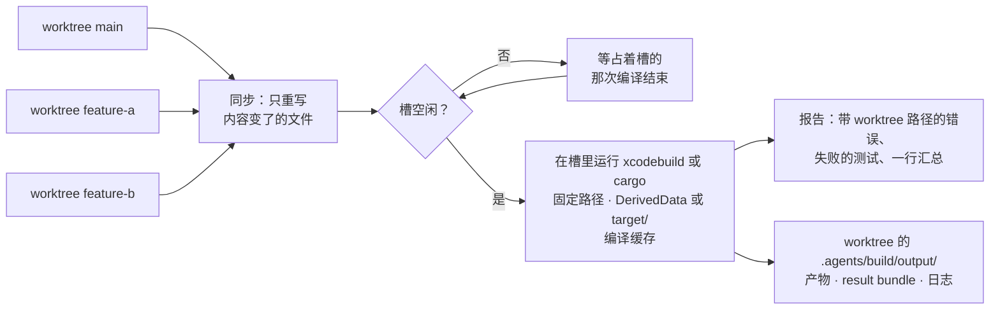

<div align="center">


# agent-build

**给"一台机器上多个 agent、多个 worktree 频繁编译"的场景，以及 CI，用的 Xcode 和 Cargo 命令行快速编译。**

同一项目的所有 worktree 都在一个固定路径的热槽里编译，<br>
新 worktree 的第一次编译是增量编译，而不是从零开始。

[](#许可证)
[](#环境要求)
[](#设定前提)
[](Cargo.toml)
[](scripts/check-deps.py)

[English](README.md) · 简体中文

[快速开始](#快速开始) · [用法](#用法) · [原理](#原理) · [常见问题](#常见问题) · [设计依据](docs/design.md)

</div>

<br>


<sub>`tests/fixtures/SampleApp` 上真实的 `xcodebuild`，剪掉了空等。用 [demo-reel](https://github.com/xiatiandeairen/demo-reel) 录制（`examples/agent-build`）。</sub>

<sub>带英文旁白的完整介绍（请开声音）：</sub>

https://github.com/user-attachments/assets/eea34804-08f6-4c09-9820-1945dad95a9d

## 目录

- [为什么需要 agent-build](#为什么需要-agent-build)
- [特性](#特性)
- [快速开始](#快速开始)
- [安装](#安装)
- [用法](#用法)
- [Rust：`agb cargo`](#rustagb-cargo)
- [设定前提](#设定前提)
- [配置](#配置)
- [原理](#原理)
- [agb 会运行什么](#agb-会运行什么)
- [隐私](#隐私)
- [常见问题](#常见问题)
- [参与开发](#参与开发)
- [许可证](#许可证)

## 为什么需要 agent-build

多个 agent 在多个 worktree 里干活时，每个新 worktree 都有自己的 DerivedData，第一次 `xcodebuild` 从零开始。两个 agent 编同一个项目会互相踩，几千行编译输出还会塞满它们的上下文。`agb` 是加在 `xcodebuild` 或 `cargo` 前面的一个词：

| 问题 | agb 怎么做 |
| --- | --- |
| 新 worktree 的第一次编译是冷编译 | 同一项目的所有 worktree 都在一个固定路径的槽里编译，增量编译从一个 worktree 延续到下一个 |
| 切回以前编过的分支又要重新编 | 在槽里打开 Xcode 的编译缓存，编过一次的东西直接从缓存取 |
| 两个 agent 同时编同一个项目会互相踩 | 同一项目的编译排队进行，后来的等前一个结束，再在热槽里增量编译；不同项目互不等待 |
| 几千行输出塞满 agent 的上下文 | 只打印错误（编译器格式、worktree 路径）、失败的测试和一行汇总，完整输出写进日志 |
| 没人说得清编译为什么慢 | 报告各阶段耗时、缓存命中和未命中、未命中最多的 target，以及哪条[设定前提](#设定前提)没满足 |

在本仓库的样例 App 上（Xcode 27.2，Apple Silicon，2026-11-23 实测），新 worktree 的第一次编译，直接用 `xcodebuild` 要 4.8 秒，用 `agb` 只要 1.3 秒，输出也从 646 行变成 5 行。在一个 2400 个文件的 App 上，同一设计的早期原型把新 worktree 的第一次编译从 178 秒降到 45 秒；当前版本还没在那个 App 上测过。

agb 只管编译在哪里跑、怎么跑，不管整台机器同时跑几个编译；要限并发，配一个队列，比如 [agent-quay](https://github.com/xiatiandeairen/agent-quay)。

## 特性

- **直接替换。** 参数和 `xcodebuild`、`cargo` 完全一样，前面加 `agb`。标准工程不用任何配置。
- **精确同步。** 每次把 worktree 的确切状态（含未提交的改动）同步进槽，只重写内容变了的文件，没变的文件保留时间戳，不会被重新编译。
- **以正确为前提。** 只有影响结果的输入全都一样时才复用。工程不满足某条[设定前提](#设定前提)时，agb 不替它兜底，而是指出是哪一条。
- **短、agent 读得懂的报告。** 指向你 worktree 的编译器格式错误、`agb: test failed:` 行，以及一行 `agb: ok` / `agb: failed` 汇总。
- **产物留在 worktree 里。** 产物、result bundle、archive 和日志都在该 worktree 的 `.agents/build/output/`，别的 worktree 编译不会碰它。
- **Xcode 和 Rust 都支持。** `agb cargo` 让 Cargo 项目用上同样的槽、同步、锁和输出。
- **不用额外运行任何东西。** 没有常驻进程，不用第三方 crate；槽放在缓存目录里，随时可以删。

## 快速开始

```bash
# 1. 安装 agb（需要 Rust 1.85+）
cargo install --git https://github.com/xiatiandeairen/agent-build --locked agent-build

# 2. 在项目的任意一个 worktree 里，把 agb 加在 xcodebuild 前面
agb xcodebuild build -workspace App.xcworkspace -scheme App -destination 'generic/platform=iOS Simulator'
```

一个项目的第一次编译是冷的；之后这个项目的每个 worktree 都在同一个槽里增量编译。要让 agent 自己用上 agb，把 [skill](#agent-skill) 给它。

## 安装

### 环境要求

- macOS，装有命令行 Xcode（在 Apple Silicon 上用 Xcode 27.2 验证过）
- 项目在 git 里，子模块在本机拿得到
- 编译 agb 需要 Rust 1.85 或更高

### 从源码安装

```bash
cargo install --git https://github.com/xiatiandeairen/agent-build --locked agent-build
```

也可以在检出目录里运行 `just install`，编好后装到 `~/.local/bin/agb`。

### Agent skill

[`skill/SKILL.md`](skill/SKILL.md) 告诉 agent 什么时候用 `agb xcodebuild` 和 `agb cargo`、怎么读它们的输出。在 Claude Code 里，把它链接到 skills 目录：

```bash
ln -s "$PWD/skill" ~/.claude/skills/agb    # 在 agent-build 检出目录里运行
```

skill 只是说明，本身不运行任何东西。

## 用法

```bash
cd my-app                                   # 项目的任意一个 worktree
agb xcodebuild build -scheme App -destination 'generic/platform=iOS Simulator'
agb xcodebuild test -scheme App -destination 'platform=iOS Simulator,name=iPhone 17 Pro'
agb xcodebuild archive -scheme App          # 打印 archive=<路径>.xcarchive
agb cargo build --release                   # Rust，见下文
```

### 输出

编译过程中输出写进日志，终端只显示一行日志路径（想看就 `tail -f`）。编完后 agb 读 Xcode 的 result bundle，打印一份简短报告。上面演示里的那次运行：在第二个 worktree 里写错一个名字之后（路径已缩短）：

```console
$ agb xcodebuild build -scheme App -destination 'generic/platform=iOS Simulator'
agb: building in slot app-c1147f35; xcodebuild's full output: …/app-feature/.agents/build/output/build.log
…/app-feature/App/App.swift:6:37: error: Type 'Greeting' has no member 'title'
agb: phases resolve=0.0s graph=0.0s plan=0.0s execute=1.0s
agb: top misses: App 4
agb: results=…/app-feature/.agents/build/output/result.xcresult
agb: failed slot=app-c1147f35 sync=0.0s build=1.8s cache hit=0 miss=4 errors=1 warnings=0 log=…/app-feature/.agents/build/output/build.log
```

- 错误按编译器的格式打印，带 worktree 路径，编辑器和 agent 能直接跳过去。警告只计数，完整列表在 result bundle 和日志里。
- 失败的测试打印成 `agb: test failed: <测试>: <信息>`。没满足设定前提的 target 打印成 `agb: precondition P4 not met: …`。
- 编译成功但 Xcode 记了错误的（通常是构建脚本打印了 `error:` 却以 0 退出），打印成 `agb: error that did not fail the build: …`，不计入 `errors=`。
- 编译失败又没留下 result bundle 时（比如工程读不了），改为打印原始输出的最后 30 行。
- `-showBuildSettings`、`-list`、`-resolvePackageDependencies` 这类只打印信息的命令，原样显示 xcodebuild 的输出。

### 产物在哪

编译成功还会打印 `products=<路径>`，`archive` 会打印 `archive=<路径>.xcarchive`。一次运行交给你的东西都在该 worktree 的 `.agents/build/output/`：产物、result bundle、archive 和 `build.log`。这个目录自带 git 忽略。别的 worktree 编译不会改它；这个 worktree 下一次同类编译会替换它，要留的先拷走。

产物位置由 agb 决定：

- `-derivedDataPath`、`-archivePath`、`-resultBundlePath`、`-clonedSourcePackagesDirPath` 会被去掉，并给出提示。
- 传给 `-workspace`、`-project` 或 `-xctestrun` 的、指向 worktree 内的绝对路径（如 `$PWD/App.xcworkspace`）会改指向槽里的副本，并给出提示。

### 退出码

| 退出码 | 含义 | 下一步 |
| --- | --- | --- |
| xcodebuild 或 cargo 自己的（0、65 等） | 编译跑了，这是它的结果 | 读汇总行上面的错误，或日志 |
| 64 | 用法错误（和 xcodebuild 自己参数错误时一样） | 改调用；cargo 中 agb 拒绝的命令，直接用 cargo 运行 |
| 125 | 同步到槽失败，没有编译 | 读报错，通常是 worktree 里的 git 或磁盘问题 |
| 128 + 信号值 | 编译被终止 | 重新运行 |

### 并发与 CI

同一项目的两次编译排队进行：后来的打印 `agb: waiting for the slot: <占着槽的是谁>`，然后在热槽里增量编译。不同项目互不等待。CI 用同样的命令；把 runner 配成不同时跑同一项目的两个任务。

## Rust：`agb cargo`

同样的槽、同步、锁和输出也服务 Cargo 项目：

```console
$ agb cargo build
agb: building in slot crate-b481e086; cargo's full output: …/crate/.agents/build/output/build.log
agb: rebuilt: sample-core, sample-ffi
agb: products=…/crate/.agents/build/output/target (replaced by this worktree's next agb build; copy what you keep)
agb: ok slot=crate-b481e086 sync=0.1s build=1.3s units fresh=0 rebuilt=4 errors=0 warnings=0 log=…/crate/.agents/build/output/build.log
```

- Cargo 在槽里运行，用槽里的 `target/`，所以 Cargo 自己的增量编译能从一个 worktree 延续到下一个。
- 支持：`build`、`check`、`test`、`bench`、`run`、`doc`、`clippy`、`rustc`、`clean`。会改文件的（`fmt`、`fix`、`add`、`update`）、安装、发布和只查询的命令会以退出码 64 拒绝，这些请直接用 cargo 运行。
- `--target-dir`、`--message-format` 和 `CARGO_TARGET_DIR` 由 agb 决定，会被去掉并给出提示。
- rustc 不经过 sccache 这类 wrapper 运行：rustc wrapper 相关的环境变量被置空，这也会覆盖 Cargo 配置里的 `build.rustc-wrapper`。wrapper 的缓存键可能漏掉影响结果的输入，复用只交给 Cargo 自己判断。
- `build` 或 `rustc` 之后，你要的那些 package 的产物（`.a`、`.dylib`、可执行文件）会按 target 目录里的同样路径拷到 `.agents/build/output/target/`，如 `.agents/build/output/target/aarch64-apple-ios/release/libcore_ffi.a`，cargo 之后的打包步骤（bindings、`lipo`、xcframework）从这里读。
- 错误打印成 `路径:行:列: error: 信息`，rustc 的完整文字在日志里。
- 除 P3、P5、P8 外的设定前提：编译只取决于源码、`Cargo.lock`、工具链，以及构建脚本声明的输入（`rerun-if-changed`、`rerun-if-env-changed`）。

## 设定前提

满足这些条件时，agent-build 又快又正确；工程不满足时，它不替工程修。

| # | 设定前提 | 不满足时 |
| --- | --- | --- |
| P1 | 用命令行 `xcodebuild` 编译（Swift；混编 ObjC/C 可以） | 用不了 |
| P2 | 当前正式版 Xcode（验证过 27.2） | 不保证 |
| P3 | 代码在 git 里；子模块在本机拿得到 | 用不了 |
| P4 | Swift target 开着 explicit modules | 结果正确但更慢；按 target 报告 |
| P5 | 构建脚本不改写被 git 跟踪的文件 | 结果正确但更慢；报告被改写的文件 |
| P6 | 宏插件这类构建工具编出来的结果可复现 | 结果正确但更慢；见下方自检 |
| P7 | 缓存只在单机内共享 | — |
| P8 | 从干净的检出、在任意目录下直接运行 `xcodebuild` 就能编过；编译需要的被 git 忽略的文件在 `.agents/build/config.yaml` 里声明 | 编译失败；错误里带着缺失文件的路径时，agb 指出是哪个被忽略的文件、该怎么声明 |

P6 自检：只删掉槽里 DerivedData 中编好的宏插件，再编一次。命中数下降，说明插件二进制不可复现。

## 配置

不需要配置。唯一的全局设置是每个项目编译缓存的大小上限，在 `$XDG_CONFIG_HOME/agent-build/config.yaml`（默认 `~/.config/agent-build/config.yaml`）：

```yaml
cache_limit: 20G   # 默认值；二进制单位，1G = 1024³ 字节
```

Xcode 不会执行这个上限，所以一次编译后缓存超过 `cache_limit` 时，agb 会清空这个项目的缓存，下一次编译重新填满。

编译需要被 git 忽略的文件（生成代码、`Pods/`、编好的 xcframework）的项目，在仓库根目录的 `.agents/build/config.yaml` 里列出它们，随项目一起提交。之后它们和被跟踪的文件一样同步：

```yaml
ignored_inputs:
  - rust-core/build/
  - App/Generated.swift
```

## 原理



- 每个项目一个固定路径的编译槽：一份 git clone，加一个常驻的 DerivedData（或 Cargo 的 `target/`）。路径不变，增量编译就能从一个 worktree 延续到下一个。
- 槽里的编译缓存提供编过一次的东西，比如以前编过的分支。
- 槽和缓存放在 `$XDG_CACHE_HOME/agent-build/`（默认 `~/.cache/agent-build/`），随时可以删，下一次编译只是重新变冷。
- [docs/design.md](docs/design.md) 讲目标、范围，以及每个机制为什么这样设计。

## agb 会运行什么

agb 只运行你要它运行的，加上把它放进槽里所需的步骤：

- `xcodebuild` 或 `cargo`，带你的参数，在槽里运行。对 xcodebuild，它会加上 `-derivedDataPath`、`-resultBundlePath` 和打开编译缓存的 `COMPILATION_CACHE_*` 构建设置。
- `git`，只作用于你的 worktree 和槽：只读查询（`rev-parse`、`status`、`ls-files`、`cat-file`、`config --get remote.origin.url`），以及在槽里从你本地的 worktree `clone`、`fetch`、`checkout`。这些调用都关掉了 hook。
- `xcrun xcresulttool`，只读，在 xcodebuild 跑完后读 result bundle。
- `cp`，把产物从槽里拷到 `.agents/build/output/`。

## 隐私

agb 只在本机运行，不发送遥测，自己不发起任何网络连接；槽是从你本地的 worktree clone 和 fetch 的。它启动的编译工具和不用 agb 时一样：xcodebuild 可能解析 Swift 包、cargo 可能下载 crate，由你的项目配置决定。

## 常见问题

<details>
<summary><b>能让 Xcode App 里的编译变快吗？</b></summary>

不能。agent-build 面向 agent、脚本和 CI 运行的命令行 `xcodebuild` 和 `cargo`。
</details>

<details>
<summary><b>结果和干净编译一样吗？</b></summary>

这是设计目标：只有影响结果的输入全都一样时才复用。只要工程满足[设定前提](#设定前提)就成立；某条不满足时，agb 会报告是哪一条，而不是去猜。
</details>

<details>
<summary><b>多个 agent 能同时编译吗？</b></summary>

能。同一项目的编译在它的槽里排队，不同项目并行编译。要限制整台机器同时跑几个编译，经队列运行 agb，比如 [agent-quay](https://github.com/xiatiandeairen/agent-quay)：`aq run -- agb xcodebuild …`。
</details>

<details>
<summary><b>我的编译需要一个被 git 忽略的生成文件，为什么在槽里会失败？</b></summary>

槽里有 worktree 的文件（含未提交的改动），但没有被 git 忽略的文件。在 `.agents/build/config.yaml` 里列出这些被忽略的输入（见[配置](#配置)）；错误里带着缺失文件的路径时，agb 会告诉你是哪一个。
</details>

<details>
<summary><b>我传的 <code>-derivedDataPath</code> 去哪了？</b></summary>

产物位置由 agb 决定：这个参数会被去掉并给出提示，一次运行交给你的东西都在该 worktree 的 `.agents/build/output/`。
</details>

<details>
<summary><b>怎么释放磁盘空间？</b></summary>

随时删除 `$XDG_CACHE_HOME/agent-build/`（默认 `~/.cache/agent-build/`），每个项目的下一次编译只是重新变冷。每个项目的编译缓存也受 `cache_limit` 限制。
</details>

## 参与开发

欢迎提 issue 和 pull request。提交改动前：

```bash
just check           # 格式、lint、单元和集成测试、文件大小、依赖、用例表
just smoke           # 在样例工程上跑真实的 xcodebuild（几分钟；经 aq 借一台 iOS 模拟器）
```

- 不用第三方 crate，`agent-build-core` 不依赖任何东西（`just deps` 检查）。
- 新行为先写进 [`docs/cases.md`](docs/cases.md)，再给守护它的测试标上用例编号。
- 读 [`docs/design.md`](docs/design.md) 了解目标、范围，以及每个机制为什么这样设计。

## 许可证

可任选 [Apache License, Version 2.0](LICENSE-APACHE) 或 [MIT license](LICENSE-MIT) 授权。
