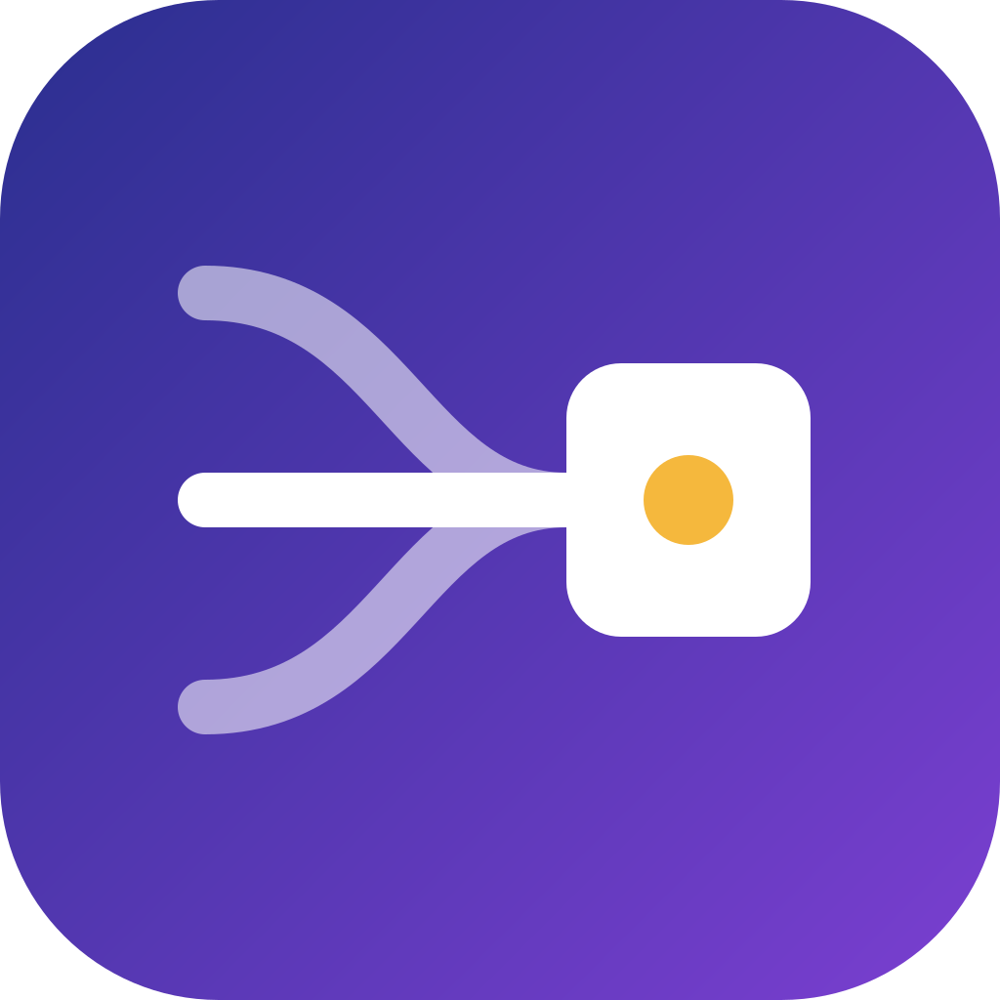
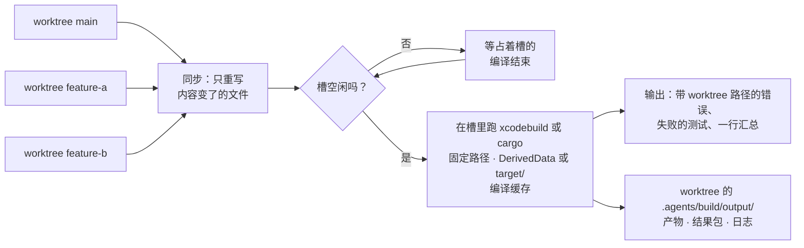

<div align="center">



# agent-build

**给"一台机器上多个 agent、多个 worktree 频繁编译"的场景，以及 CI，用的 Xcode 和 Cargo 命令行快速编译。**

同一项目的所有 worktree 都在一个固定路径的热槽里编译，<br>
新 worktree 的第一次编译是增量编译，而不是从零开始。

[](#许可证)
[](#环境要求)
[](#设定前提)
[](Cargo.toml)
[](scripts/check-deps.py)

[English](README.md) · 简体中文

[快速开始](#快速开始) · [用法](#用法) · [原理](#原理) · [常见问题](#常见问题) · [设计依据](docs/design.md)

</div>

<br>


<sub>`tests/fixtures/SampleApp` 上真实的 `xcodebuild`。用 `docs/demo/record.sh` 可重录。</sub>

## 目录

- [为什么需要 agent-build](#为什么需要-agent-build)
- [特性](#特性)
- [快速开始](#快速开始)
- [安装](#安装)
- [用法](#用法)
- [Rust：`agb cargo`](#rustagb-cargo)
- [设定前提](#设定前提)
- [配置](#配置)
- [原理](#原理)
- [常见问题](#常见问题)
- [参与开发](#参与开发)
- [许可证](#许可证)

## 为什么需要 agent-build

agent 在多个 worktree 里干活时，每个新 worktree 都有自己的 DerivedData，第一次 `xcodebuild` 从零开始。改为在命令前加上 `agb`：

| 问题 | agb 怎么做 |
| --- | --- |
| 新 worktree 第一次编译是冷编译 | 同一项目的所有 worktree 都在一个固定路径的槽里编译，Xcode 的增量编译从一个 worktree 延续到另一个 |
| 切回之前编过的分支又要重编 | 在槽里打开 Xcode 的编译缓存，编过一次的东西直接复用 |
| 两个 agent 同时编同一个项目，互相踩 | 同一项目的编译排队：后到的等前一个编完，再在热槽上增量编译。不同项目互不等待 |
| `xcodebuild` 几千行输出塞满 agent 的上下文 | 只输出错误（编译器格式，worktree 路径）、失败的测试和一行汇总，完整输出写进日志 |
| 说不清编译为什么慢 | 报告每个阶段的耗时、缓存命中和未命中、未命中最多的 target，以及哪条[前提](#设定前提)没满足 |

用同一设计的前期原型，在一个约 2400 个 Swift 文件的 App 上实测（Xcode 27.2）：新 worktree 首次编译从冷编译的 178 秒降到 45 秒。当前版本还没在这个 App 上测过。

## 特性

- **直接替换。** 参数和 `xcodebuild`、`cargo` 一样，前面加 `agb` 即可。标准工程不用写配置。
- **精确同步。** 每次运行把 worktree 的当前状态原样同步进槽，只重写内容变了的文件，没变的文件保持原样，不会被重编。
- **正确性靠设计。** 只有影响结果的输入全部相同才复用；工程不满足[前提](#设定前提)时，agb 不替它兜底，而是指出是哪一条。
- **对 agent 友好的输出。** 编译器格式、指向你的 worktree 的错误，`agb: test failed:` 行，加一行 `agb: ok` / `agb: failed` 汇总。
- **产物留在 worktree 里。** 产物、结果包、归档和日志都在 worktree 的 `.agents/build/output/`，别的 worktree 编译不会动它。
- **Xcode 和 Rust 都管。** `agb cargo` 让 Cargo 项目用同一套槽、同步、槽锁和 output。
- **不用额外维护。** 没有常驻服务，不引入第三方 crate；槽放在缓存目录里，随时可以删。

## 快速开始

```bash
# 1. 安装 agb（需要 Rust 1.85 及以上）
cargo install --git https://github.com/xiatiandeairen/agent-build --locked agent-build

# 2. 在项目的任意一个 worktree 里，在 xcodebuild 前加上 agb
agb xcodebuild build -workspace App.xcworkspace -scheme App -destination 'generic/platform=iOS Simulator'
```

一个项目第一次编译是冷编译；之后这个项目的每个 worktree 都在同一个槽里增量编译。要让 agent 用上它，把 [skill](#agent-skill) 交给 agent。

## 安装

### 环境要求

- macOS，装有命令行 Xcode（已在 Xcode 27.2 上验证）
- 项目代码在 git 里，子模块本机拿得到
- 编译 agb 需要 Rust 1.85 及以上

### 从源码安装

```bash
cargo install --git https://github.com/xiatiandeairen/agent-build --locked agent-build
```

或者在检出的仓库里运行 `just install`，编译并安装到 `~/.local/bin/agb`。

### Agent skill

[`skill/SKILL.md`](skill/SKILL.md) 告诉 agent 什么时候用 `agb xcodebuild`、`agb cargo`，以及怎么读它们的输出。在 Claude Code 里，把它链接进 skills 目录：

```bash
ln -s "$PWD/skill" ~/.claude/skills/agb    # 在 agent-build 仓库目录里运行
```

## 用法

```bash
cd my-app            # 项目的任意一个 worktree
agb xcodebuild build -workspace App.xcworkspace -scheme App -destination 'generic/platform=iOS Simulator'
agb xcodebuild test -scheme App -destination 'platform=iOS Simulator,name=iPhone 17 Pro'
```

### 能看到什么

编译期间，xcodebuild 的输出只写进日志文件，终端只有开头一行（给出日志路径，想看过程可以 `tail -f`）。编完后，agb 用 `xcresulttool` 读 Xcode 的结果包（xcresult），依次输出：

```
/Users/me/my-app/App/Login.swift:42:9: error: Cannot find 'session' in scope
agb: test failed: CoreTests/testLogin(): XCTAssertEqual failed: ("1") is not equal to ("2")
agb: phases resolve=7.7s graph=5.5s plan=2.0s execute=18.6s
agb: precondition P4 not met: App (explicit modules off) — their Swift compiles are not cached
agb: top misses: MXAIModule 15, MXAIUIModule 8
agb: results=/Users/me/my-app/.agents/build/output/result.xcresult
agb: failed slot=my-app-1a2b3c4d sync=1.1s build=35.9s cache hit=46 miss=23 errors=1 warnings=12 log=/Users/me/my-app/.agents/build/output/build.log
```

- 错误按编译器的格式输出，路径是 worktree 里的，编辑器和 agent 可以直接跳过去；警告只计数，完整内容在结果包和日志里。
- 编译成功（退出码 0）但 Xcode 仍记了错误时（典型是构建脚本打印 `error:` 却以 0 退出），这些错误每条一行 `agb: error that did not fail the build: …`，不按编译器格式输出，也不计入汇总行的 `errors=`。
- 编译失败但读不到结果包时（比如工程文件读不了），改为输出原始输出的最后 30 行。
- `-showBuildSettings`、`-list` 这类只打印信息的命令，原样输出 xcodebuild 的内容。
- 编译成功时还会给出 `products=<路径>`，`archive` 给出 `archive=<路径>.xcarchive`；编译失败时只给结果包路径。交给你的东西（产物、结果包、归档、`build.log`）都在 worktree 的 `.agents/build/output/` 里，这个目录自己不进 git。别的 worktree 编译不会动它；这个 worktree 下次产出同类东西的运行会替换它，要保留就复制走。`test-without-building` 不动它要测的产物，信息命令什么都不动。
- `-derivedDataPath`、`-archivePath`、`-resultBundlePath`、`-clonedSourcePackagesDirPath` 会被丢掉并提示：输出放在 `.agents/build/output/`，包检出留在槽里。
- `-workspace`、`-project`、`-xctestrun` 的值如果是 worktree 里的绝对路径（例如 `$PWD/App.xcworkspace`），会改指向槽里的同一份，并提示。
- `-resolvePackageDependencies` 按信息命令处理，解析出的包放进槽里。

### 退出码

| 码 | 含义 |
| --- | --- |
| xcodebuild 或 cargo 自己的 | 编译跑了，原样返回结果 |
| 64 | 参数错误（与 xcodebuild 自己的参数错误相同） |
| 125 | 同步槽失败，没有编译（沿用 `env`、`timeout` 表示"包装器自己失败"的惯例） |

### 并发与 CI

同一项目的两个编译会排队：后到的会输出在等谁，等前一个结束后在热槽上增量编译。不同项目互不等待。机器上同时跑几个编译，交给你的排队工具（例如 [agent-quay](https://github.com/xiatiandeairen/agent-quay)）。CI 用同一条命令，把 runner 配成同一项目不并发即可。

## Rust：`agb cargo`

Cargo 项目用同一套槽、同步、槽锁和 output。在 `cargo` 前加上 `agb`：

```bash
agb cargo build --release -p core-ffi --target aarch64-apple-ios
agb cargo test
```

- cargo 在槽里运行，用槽里的 `target/`，Cargo 自己的增量编译就能从一个 worktree 延续到另一个。只接受 `build`、`check`、`test`、`bench`、`run`、`doc`、`clippy`、`rustc`、`clean`；改文件（`fmt`、`fix`、`add`、`update`）、安装、发布和只读查询的子命令返回退出码 64，请直接用 cargo。
- `--target-dir`、`--message-format` 和 `CARGO_TARGET_DIR` 由 agb 接管，传了会被丢掉并提示。
- rustc 不经过 wrapper（kache、sccache）：rustc wrapper 相关的环境变量设为空，也盖过 Cargo 配置里的 `build.rustc-wrapper`。wrapper 的缓存 key 可能漏掉影响结果的输入，复用只由 Cargo 自己判断。
- `build`、`rustc` 成功后，你要求的包的产物（`.a`、`.dylib`、程序）拷到 `.agents/build/output/target/`，路径和 target 目录里一样，例如 `.agents/build/output/target/aarch64-apple-ios/release/libcore_ffi.a`。cargo 之后的出包步骤（生成绑定、`lipo`、打 xcframework）从这里读。
- 编完输出：错误按 `路径:行:列: error: 信息`（rustc 的完整文字在日志里）、失败的测试、`agb: rebuilt: <重编的本项目包>`，以及带 Cargo 自己计数 `units fresh=… rebuilt=…` 的汇总行。
- 在 P3、P5、P8 之外的前提：编译结果只取决于源码、`Cargo.lock`、工具链和构建脚本声明过的输入（`rerun-if-changed`、`rerun-if-env-changed`）。

## 设定前提

满足这些前提时，agent-build 又快又正确；不满足时，它不替工程修。

| # | 前提 | 不满足时 |
|---|---|---|
| P1 | 用命令行 `xcodebuild` 编译（Swift，混编 ObjC/C 可以） | 用不了 |
| P2 | 当前正式版 Xcode（已在 27.2 上验证） | 不保证 |
| P3 | 代码在 git 里，子模块本机拿得到 | 用不了 |
| P4 | Swift target 开着 explicit modules | 正确但变慢；按 target 报告 |
| P5 | 构建脚本不改写被跟踪的文件 | 正确但变慢；列出被改写的文件 |
| P6 | 宏插件这类构建工具编出来的结果可复现 | 正确但变慢；见下 |
| P7 | 缓存只在单机内共享 | — |
| P8 | 从干净检出、在任意目录下直接运行 `xcodebuild` 就能编过；编译需要的被 git 忽略的文件在 `.agents/build/config.yaml` 里声明 | 编译失败；错误里带着缺的文件路径时，agb 点名是哪个被忽略的文件、怎么声明 |

P6 自查：只删掉槽的 DerivedData 里编好的宏插件，再编一次。命中数明显下降，说明插件二进制不可复现。

## 配置

不需要配置。全局唯一的配置项是每个项目编译缓存的上限，写在 `$XDG_CONFIG_HOME/agent-build/config.yaml`（默认 `~/.config/agent-build/config.yaml`）：

```yaml
cache_limit: 20G
```

工程编译需要被 git 忽略的文件时（生成的代码、`Pods/`、编好的 xcframework），在仓库根目录的 `.agents/build/config.yaml` 里列出来，随项目提交。之后这些文件和被跟踪的文件一样同步：

```yaml
ignored_inputs:
  - rust-core/build/
  - App/Generated.swift
```

Xcode 不执行这个上限，所以某次编译后某个项目的缓存超过 `cache_limit`（二进制单位：1G = 1024³ 字节）时，agb 把它清掉，下次编译重新填充。每个项目的缓存放在它的槽里，删槽就连缓存一起删了。

## 原理



- 每个项目在本机有一个固定路径的构建槽：一份 git 克隆，加一个常驻的 DerivedData（或 Cargo 的 `target/`）。路径固定，Xcode 的增量编译就能从一个 worktree 延续到另一个。
- 槽里的编译缓存让编过一次的东西直接复用，比如切回之前编过的分支。
- 构建槽和缓存在 `$XDG_CACHE_HOME/agent-build/`，随时可以删，删了只会让下次编译变慢。交给你的东西（含日志）在 worktree 的 `.agents/build/output/`，随 worktree 一起删。

## 常见问题

<details>
<summary><b>能让 Xcode 里的编译也变快吗？</b></summary>

不能。agent-build 只管命令行的 `xcodebuild` 和 `cargo`，给 agent、脚本和 CI 用。
</details>

<details>
<summary><b>结果和从零编译一样吗？</b></summary>

这是设计目标：只有影响结果的输入全部相同才复用。工程满足[设定前提](#设定前提)时成立；有前提没满足时，agb 报告是哪一条，不去猜。
</details>

<details>
<summary><b>多个 agent 能同时编译吗？</b></summary>

能。同一项目的编译在它的槽里排队，不同项目并行。要限制整台机器同时跑几个编译，经 [agent-quay](https://github.com/xiatiandeairen/agent-quay) 这样的排队工具运行：`aq run -- agb xcodebuild …`。
</details>

<details>
<summary><b>编译需要一个被 git 忽略的生成文件，为什么在槽里编不过？</b></summary>

槽里有 worktree 的文件（包括没提交的改动），但不包括 git 忽略的文件。把这些被忽略的输入列进 `.agents/build/config.yaml`（见[配置](#配置)）；错误里带着缺的文件路径时，agb 会点名是哪一个。
</details>

<details>
<summary><b>我传的 <code>-derivedDataPath</code> 去哪了？</b></summary>

输出位置归 agb 管：这个参数会被丢掉并提示，一次运行交给你的东西都在 worktree 的 `.agents/build/output/`。
</details>

<details>
<summary><b>怎么释放磁盘空间？</b></summary>

随时删掉 `$XDG_CACHE_HOME/agent-build/`（默认 `~/.cache/agent-build/`），之后每个项目的下一次编译重新变成冷编译。每个项目的编译缓存也受 `cache_limit` 限制。
</details>

## 参与开发

欢迎提 issue 和 pull request。提交改动前：

```bash
just check           # 格式、lint、单元与集成测试、行数、依赖、用例表核对
just smoke           # 用真 xcodebuild 编样例工程（约一分钟，经 aq 借一台 iOS 模拟器）
```

- 不引入第三方 crate，`agent-build-core` 不依赖任何东西（`just deps` 检查）。
- 新行为先写进 [`docs/cases.md`](docs/cases.md)；目标、范围和每个机制为什么这样定，见 [`docs/design.md`](docs/design.md)。

## 许可证

可任选 [Apache License 2.0](LICENSE-APACHE) 或 [MIT license](LICENSE-MIT)。
